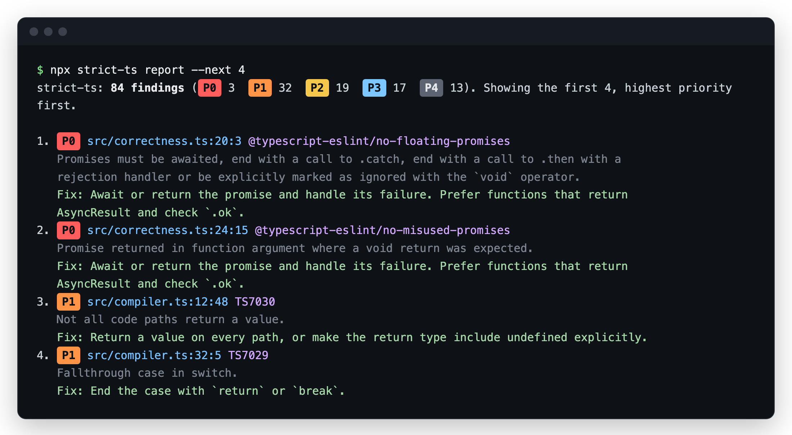
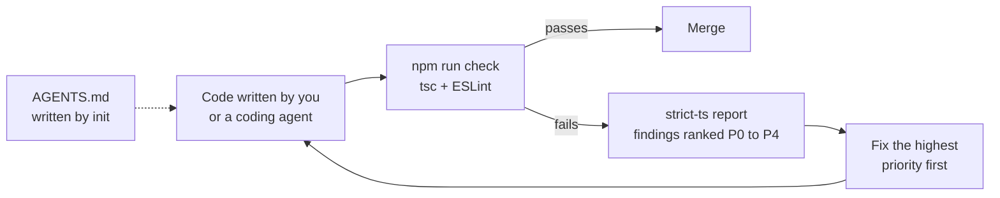

# strict-ts

Errors as values for TypeScript, enforced by the compiler and the linter.

Rust and Go make failure part of a function's return type, so a caller cannot use a value before checking whether the call failed. [neverthrow](https://github.com/supermacro/neverthrow) brings a Result type to TypeScript. strict-ts adds the configuration that makes a whole project follow it: the strictest compiler flags, lint rules that reject type assertions, `any`, discarded Results and throwing outside boundary files, and non-throwing replacements for built-ins such as `JSON.parse`, `fetch` and `new URL`.

```ts
const user = parseWith(User, input);
if (!user.ok) return sendError(res, 400, user.error);
```

<p align="center"></p>

## Quick start

```sh
npx github:wingravity/strict-ts init
npm install
npx strict-ts report --next 20
```

`init` adds the configuration and the coding-agent instructions to the project. `report` lists what needs attention, most dangerous first. `npm run check` runs the compiler and ESLint and fails on any finding; use it in CI.



## Report

`strict-ts report` runs the TypeScript compiler and ESLint together and orders every finding by the worst realistic runtime consequence of its rule. On an existing codebase, this shows where to start.

| Priority | Meaning | Examples |
|---|---|---|
| P0: Process can go down | can stop the whole process | floating promises, async callbacks where a void callback is expected |
| P1: Silent wrong result | wrong data or behavior with no error raised | `as` casts, `any`, ignored Results, `Dog[]` used as a mutable `Animal[]`, truthiness checks on numbers, non-exhaustive switches |
| P2: Request fails | throws at runtime and fails one request | possibly undefined access, `!`, throwing built-ins |
| P3: Weak error handling | makes failures likelier or harder to handle | `throw`/`try` outside boundaries, unbounded schemas and loops, truthiness checks on strings and booleans |
| P4: No runtime effect | clarity only | bracket access, unused code, redundant expressions |

```sh
npx strict-ts report                 # writes strict-ts-report.md
npx strict-ts report --next 20       # the 20 highest-priority findings, with fix instructions
npx strict-ts report --format json   # all findings as JSON
```

Each rule in the report states why it matters and how to fix it. Production code is listed before tests, and the report lists the files with the most P0 to P2 findings and any strict-ts rule or compiler flag that the project's configuration turns off or downgrades.

<details>
<summary><b>Report options</b></summary>

- `--project <tsconfig>` selects the tsconfig.
- The report includes findings recorded in `eslint-suppressions.json`. `--respect-suppressions` leaves them out (requires ESLint 10.1 or later).
- The command always exits with code 0. Use `npm run check` as the CI gate.
- Add `strict-ts-report.md` to `.gitignore` if it should not be committed.

</details>

## Coding agents

strict-ts is designed for projects where coding agents such as Claude Code, Codex, Copilot and Cursor write much of the code.

- **Instructions:** `init` adds a strict-ts section to `AGENTS.md`, the instruction file these agents read. It covers Results, the banned constructs, the safe replacements, boundary files, and the requirement that the check passes.
- **Work queue:** `npx strict-ts report --next 20` gives an agent a short, prioritized list of findings with a fix instruction for each. `--format json` gives the same data in a stable shape.
- **API reference:** `node_modules/strict-ts/docs/api.md` lists every function, its error kinds and the expected code patterns.
- **No shortcuts:** `// eslint-disable` comments have no effect, and the report shows any rule or compiler flag weakened in the configuration.

The `AGENTS.md` section sits between `<!-- strict-ts:start -->` and `<!-- strict-ts:end -->`, and running `init` again refreshes it without touching the rest of the file. Claude Code reads `AGENTS.md` unless the project has a `CLAUDE.md`, so `init` adds an `@AGENTS.md` import to an existing `CLAUDE.md`.

## Setup

Requires Node 20.3 or later, TypeScript 5.8 to 6.0, ESLint 9.35 or later (or ESLint 10) and typescript-eslint 8.

<details>
<summary><b>What <code>init</code> changes</b></summary>

| File | Change |
|---|---|
| `tsconfig.json` | adds `strict-ts/tsconfig.json` to `extends` (comments and formatting are kept) |
| `eslint.config.js` | creates it, or prints the lines to merge if one exists |
| `package.json` | adds a `check` script and `strict-ts` as a dependency pinned to the release tag |
| `AGENTS.md` | adds a strict-ts section with instructions for coding agents, or creates the file |
| `CLAUDE.md` | if it exists, adds `@AGENTS.md` so Claude Code also reads those instructions; never created |
| `.vscode/extensions.json` | recommends the ESLint extension |
| `.vscode/settings.json` | uses the project's TypeScript version and, with ESLint 10.1 or later, applies bulk suppressions in the editor |

It also prints the install command for any missing peer dependency (`typescript`, `eslint`, `typescript-eslint`). Running it again changes nothing.

- `--dry-run` previews the changes without writing.
- `--force` overwrites an existing ESLint config.
- `npx "github:wingravity/strict-ts#v0.2.0" init` runs a specific release.

</details>

<details>
<summary><b>Adopting on an existing codebase</b></summary>

1. Run `init`.
2. Run `npx eslint . --suppress-all` and commit `eslint-suppressions.json`. New code must be clean; shrink the file as you fix code with `npx eslint . --prune-suppressions`.
3. Run `npx strict-ts report` to see which findings to fix first.
4. Fix the TypeScript errors. Bulk suppressions only cover ESLint. Most fixes are mechanical: handle the `undefined` from index access, use bracket access on dynamic objects, leave optional properties out instead of passing `undefined`.
5. Wrap throwing SDKs in boundary files and list them in `throwingModules`.
6. Add `installProcessGuards` at startup.

`init` sets `"eslint.options": { "applySuppressions": true }` in `.vscode/settings.json` so the VS Code ESLint extension hides suppressed findings the same way CI does.

</details>

<details>
<summary><b>Manual setup</b></summary>

```sh
npm install "github:wingravity/strict-ts#v0.2.0"
npm install -D typescript eslint typescript-eslint
```

```jsonc
// tsconfig.json
{
  "extends": ["<your framework or base config>", "strict-ts/tsconfig.json"],
  "compilerOptions": { /* module, target, jsx... as before */ }
}
```

```js
// eslint.config.js
import strictTs from "strict-ts/eslint";

export default [
  { ignores: ["dist/**"] },
  ...strictTs({ tsconfigRootDir: import.meta.dirname }),
];
```

```jsonc
// package.json
"scripts": { "check": "tsc --noEmit && eslint ." }
```

</details>

<details>
<summary><b>Continuous integration</b></summary>

`npm run check` exits with a non-zero code on any finding. For GitHub Actions, add `.github/workflows/check.yml`:

```yaml
name: Check

on:
  pull_request:
  push:
    branches: [main]

jobs:
  check:
    runs-on: ubuntu-latest
    steps:
      - uses: actions/checkout@v4
      - uses: actions/setup-node@v4
        with:
          node-version: 24
          cache: npm
      - run: npm ci
      - run: npm run check
```

To block merging on failures, mark the **Check** job as required in the branch protection rules. For pnpm, Yarn or Bun, replace the install and run commands.

</details>

## API

<details>
<summary><b>Results</b></summary>

```ts
import { ok, err, type Result } from "strict-ts";

type ParseError = { kind: "Empty" } | { kind: "TooLong"; max: number };

function parseName(input: string): Result<string, ParseError> {
  if (input === "") return err({ kind: "Empty" });
  if (input.length > 100) return err({ kind: "TooLong", max: 100 });
  return ok(input.trim());
}
```

A Result is a plain readonly object, `{ ok: true, value }` or `{ ok: false, error }`, never a class instance. It survives `JSON.stringify`, `structuredClone`, `postMessage`, and Next.js and Astro action boundaries.

| Function | Purpose |
|---|---|
| `ok(value)`, `err(error)` | build a Result |
| `map`, `mapErr`, `andThen` | transform or chain without unwrapping |
| `match(r, { ok, err })` | handle both cases and return a value |
| `unwrapOr(r, fallback)` | the value, or a fallback on error |
| `all(results)` | all values in order, or the first error |
| `attempt(fn, toError)` | call code that may throw (boundary files only) |
| `attemptAsync(fn, toError)` | the same for promises; never rejects |

`AsyncResult<T, E>` is `Promise<Result<T, E>>`; functions returning it must never reject. Model errors as unions with a `kind` field so `switch (error.kind)` is checked for exhaustiveness.

</details>

<details>
<summary><b>Replacements for throwing built-ins</b></summary>

`strict-ts/safe` has a non-throwing replacement for each banned built-in:

| Banned | Use |
|---|---|
| `JSON.parse` | `safeJsonParse(text, { maxLength, maxDepth })` |
| `JSON.stringify` | `safeJsonStringify(value, indent?)` |
| `new URL` | `safeUrl(input, base?)` |
| `decodeURIComponent` and friends | `safeDecodeURIComponent`, `safeEncodeURIComponent`, `safeDecodeURI`, `safeEncodeURI` |
| `BigInt()` | `safeBigInt` |
| `structuredClone` | `safeStructuredClone` |
| `atob`, `btoa` | `safeAtob`, `safeBtoa` |
| `new RegExp` | a regex literal, or `safeRegExp(pattern, flags?)` |
| `fetch` | `safeFetch(url, { timeoutMs, ...init })` |
| `response.json()` | `readBody(response, { maxBytes })` + `safeJsonParse`, or `fetchJson` |

Validate external data with any [Standard Schema](https://standardschema.dev) library (Zod, Valibot, ArkType):

```ts
import { z } from "zod";
import { fetchJson } from "strict-ts/safe";

const User = z.object({ id: z.number(), name: z.string().max(200) });

const user = await fetchJson("https://api.example.com/me", User, { timeoutMs: 5_000 });
if (!user.ok) {
  if (user.error.kind === "HttpStatusError") return handleStatus(user.error.status);
  return reportFailure(user.error);
}
```

`fetchJson` requests with a timeout, checks the HTTP status, reads the body with a size cap, parses with a depth cap and validates.

</details>

<details>
<summary><b>Boundary files</b></summary>

Put code that touches throwing APIs in a boundary file (`*.boundary.ts` or a `boundary/` folder), where `try`, `throw` and the banned built-ins are allowed, and expose functions that return Results:

```ts
// billing.boundary.ts
import Stripe from "stripe";
import { attemptAsync, type AsyncResult } from "strict-ts";

const stripe = new Stripe(apiKey);

export function createCustomer(email: string): AsyncResult<Stripe.Customer, BillingError> {
  return attemptAsync(
    () => stripe.customers.create({ email }),
    (cause) => ({ kind: "StripeError", message: String(cause), cause }),
  );
}
```

Add the SDK to `throwingModules` so the rest of the code can only reach it through the boundary. List clients that throw, not helpers that don't (for Drizzle, your `db` client throws; `drizzle-orm` query builders do not).

</details>

<details>
<summary><b>Node: filesystem and process handlers</b></summary>

```ts
import { readTextFile, installProcessGuards } from "strict-ts/node";

const config = await readTextFile("config.json", { maxBytes: 100_000 });

installProcessGuards({
  log: (event) => logger.error(event),
  onFatal: () => Sentry.flush(2_000),
  onShutdown: () => server.close(),
  timeoutMs: 5_000,
});
```

- `readTextFile`, `writeTextFile`, `readDir`, `stat` and `ensureDir` return Results with the Node error code and path.
- On an uncaught exception or unhandled rejection, `installProcessGuards` logs it, runs `onFatal`, and exits 1 so the supervisor restarts a clean process.
- On `SIGTERM` or `SIGINT` it runs `onShutdown` and exits 0, or exits 1 if the hook fails or hangs past `timeoutMs`.

</details>

## Reference

<details>
<summary><b>Compiler flags</b></summary>

`strict-ts/tsconfig.json` sets only strictness flags. It does not set `module`, `target`, `jsx`, `lib` or `types`.

| Flag | Catches |
|---|---|
| `strict` | the TypeScript baseline |
| `noUncheckedIndexedAccess` | `rows[0].id` when `rows` may be empty |
| `exactOptionalPropertyTypes` | passing `undefined` where a property should be left out |
| `noPropertyAccessFromIndexSignature` | `body.key` on a dynamic object; write `body["key"]` so the lookup is visible |
| `noImplicitReturns`, `noFallthroughCasesInSwitch` | missing returns, accidental fallthrough |
| `noImplicitOverride` | overriding a method without `override` |
| `useUnknownInCatchVariables` | treating a caught value as an `Error` without checking |
| `noUnusedLocals`, `noUnusedParameters`, `allowUnreachableCode: false` | dead code |
| `verbatimModuleSyntax`, `noUncheckedSideEffectImports`, `forceConsistentCasingInFileNames` | import mistakes |

A project's own `compilerOptions` override inherited ones. Setting one of these flags to `false` locally disables it.

</details>

<details>
<summary><b>Lint rules</b></summary>

Built on typescript-eslint `strictTypeChecked` plus ESLint's full recommended set.

- **Type assertions and `any`:** `as` (except `as const`), `!`, `any`, `@ts-ignore`, `@ts-expect-error`, `@ts-nocheck`, all `no-unsafe-*` rules.
- **Correctness:**
  - Exhaustive switches: every case of a union must be listed, and `default` does not count.
  - No truthiness checks on strings or numbers, no unnecessary conditions.
  - Floating and misused promises.
  - `===` only.
  - Numbers allowed in template strings.
- **Never throw** (outside boundary files): `throw`, `try`, `Promise.reject`, `new Promise`, throwing built-ins and `throwingModules` imports.
- **Unsafe array widening:** `strict-ts/no-mutable-array-widening` reports a mutable array used as a mutable array of a wider type, such as a `Dog[]` assigned or passed where an `Animal[]` is expected. TypeScript allows this, and code holding the `Animal[]` can then add a non-Dog to the original array. Readonly targets and copies are allowed.
- **Ignored errors:** `strict-ts/must-use-result` reports a discarded Result, such as `save();` or `items.forEach((x) => save(x))`. This is the equivalent of Go's `errcheck`.
- **Bounded input and loops:** `strict-ts/bounded-schemas` requires `.max()` on Zod strings and arrays. `while`, `do...while`, `for(;;)`, generators and `setInterval` are banned.
- **No escape hatches in source:** `// eslint-disable` comments have no effect; exceptions go in `eslint.config.js`.

</details>

<details>
<summary><b>Options</b></summary>

```js
strictTs({
  tsconfigRootDir: import.meta.dirname,
  throwingModules: ["stripe", "minio", "resend"],
  boundary: ["**/*.boundary.ts", "**/boundary/**"],
  tests: ["**/*.test.ts", "**/*.spec.ts", "**/__tests__/**"],
  files: ["**/*.ts", "**/*.tsx", "**/*.mts", "**/*.cts"],
  allowInlineDisable: false,
});
```

| Option | Purpose |
|---|---|
| `throwingModules` | packages importable only from boundary files (matches the package and its subpaths) |
| `boundary` | files where throwing code is allowed |
| `tests` | test files, where type-safety and boundary rules are relaxed |
| `files` | files the config applies to |
| `allowInlineDisable` | `true` makes `// eslint-disable` comments work again |

</details>

<details>
<summary><b>Tests</b></summary>

Test code never reaches production, so in files matching `tests` the type-safety and boundary rules are off (`no-unsafe-*`, `as`, `!`, truthiness, throw and `try` bans, restricted imports). Rules that catch real test bugs stay on: floating promises (an un-awaited assertion passes silently), `must-use-result`, `eqeqeq` and ESLint's recommended set.

Compiler flags apply to every file in a tsconfig. If tests need looser compiler settings, give them their own tsconfig.

</details>

<details>
<summary><b>Adopting on an existing codebase</b></summary>

1. Run `init`.
2. Run `npx eslint . --suppress-all` and commit `eslint-suppressions.json`. New code must be clean; shrink the file as you fix code with `npx eslint . --prune-suppressions`.
3. Run `npx strict-ts report` to see which findings to fix first.
4. Fix the TypeScript errors. Bulk suppressions only cover ESLint. Most fixes are mechanical: handle the `undefined` from index access, use bracket access on dynamic objects, leave optional properties out instead of passing `undefined`.
5. Wrap throwing SDKs in boundary files and list them in `throwingModules`.
6. Add `installProcessGuards` at startup.

`init` sets `"eslint.options": { "applySuppressions": true }` in `.vscode/settings.json` so the VS Code ESLint extension hides suppressed findings the same way CI does.

</details>

See [CONTRIBUTING.md](CONTRIBUTING.md) for development and releases.

## License

MIT
